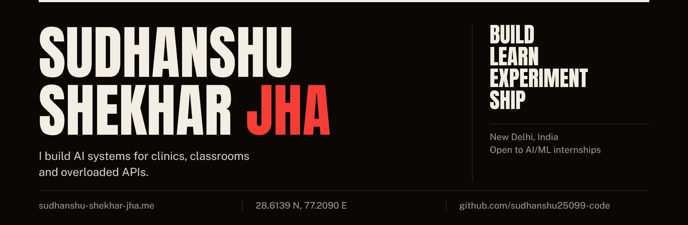

<div align="center">
  
</div>

> **I don't build AI demos. I build systems around real problems.**

Computer Science Engineering student at the Faculty of Technology, University of Delhi. My work sits where a model has to be right: a student in crisis, a prescription on a clinic desk, a service absorbing a traffic spike.

<p>
  <a href="https://sudhanshu-shekhar-jha.me/"></a>&nbsp;
  <a href="https://www.linkedin.com/in/sudhanshu-shekhar-jha-b0aaa9377/"></a>&nbsp;
  <a href="https://github.com/sudhanshu25099-code"></a>&nbsp;
  <a href="mailto:sudhanshushekharjha2007@gmail.com"></a>
</p>

## 01 &nbsp; Working principle

Good engineering starts with the problem, not the framework. Three rules I keep:

- **Empathy first** — Anxiety detection, queue bottlenecks, clinical admin. The problem picks the stack, not the other way round.
- **Latency is a feature** — Groq LPUs and lean token pipelines, so a conversation feels like one turn instead of a round trip.
- **Standards, or it stays a demo** — HL7 FHIR R4 bundles, clean SQL schemas, backends that hold up under concurrent load.

## 02 &nbsp; Right now

```
role      cse student, faculty of technology, university of delhi
focus     generative ai, nlp, clinical systems, low-latency inference
building  student wellness ai, clinical intake, ehr workspace, rate limiter
open to   ai/ml internships, hackathon teams, open source
```

## 03 &nbsp; Selected work

### 01 Student Wellness AI

Conversational support for students, with distress-signal triage and guided decompression. About 180 ms per reply on Groq.

```
user input  →  llama 3.3 / groq  →  signal triage  →  decompression
```

`Llama 3.3` `Groq` `Flask` `SQLAlchemy` `Tailwind`

[Live demo](https://student-wellness-app.onrender.com/) &nbsp;&nbsp; [Source](https://github.com/sudhanshu25099-code/student-wellness-app_GFG26)

---

### 02 AI Clinical Intake

Voice-first intake and prescription OCR that turn a consultation into an ABDM-aligned HL7 FHIR R4 bundle before the doctor sees the patient.

```
speech + document  →  gemini api  →  structured extraction  →  fhir r4 bundle  →  opd queue
```

`Gemini API` `Web Speech` `LayoutLM` `FastAPI` `React` `FHIR R4`

[Source](https://github.com/sudhanshu25099-code/Medkiosk-By_Blackops)

---

### 03 Clinical EHR

Administration, OPD, nursing triage, diagnostics and LLM summarisation in one workspace, on a 38-table MySQL schema.

```
streamlit  →  fastapi  →  groq llm layer  →  mysql 8 (38 tables)
```

`FastAPI` `Streamlit` `Groq` `MySQL` `SQLAlchemy` `Pydantic v2`

[Source](https://github.com/sudhanshu25099-code/patient-case-taking)

---

### 04 API Traffic Control

A distributed rate limiter for FastAPI. PostgreSQL stores the policy, Redis and atomic Lua enforce it per client, in O(1) time and memory.

```
request  →  asgi middleware  →  postgres (rule lookup)  →  redis lua (counter)  →  200 / 429
```

- **Fixed Window:** O(1) time & memory · 1–2 Redis ops/req · bursts up to 2× limit at window boundary
- **Token Bucket:** O(1) time & memory · 1 Redis Lua op/req · bursts to capacity, then steady rate

[Source](https://github.com/sudhanshu25099-code/api-traffic-control)

## 04 &nbsp; Stack

### AI & Machine Learning
<p>
  &nbsp;
  &nbsp;
  &nbsp;
  &nbsp;
  &nbsp;
  
</p>

### Web & Backend
<p>
  &nbsp;
  &nbsp;
  &nbsp;
  &nbsp;
  &nbsp;
  &nbsp;
  
</p>

### Databases & DevOps
<p>
  &nbsp;
  &nbsp;
  &nbsp;
  &nbsp;
  &nbsp;
  &nbsp;
  
</p>

## 05 &nbsp; GitHub Activity

<p align="center">
  
</p>

## 06 &nbsp; Horizon

- **Agentic AI:** Multi-agent orchestration that survives a failing tool
- **Retrieval:** Modular RAG with vector search, measured rather than assumed
- **Multimodal:** Speech and documents into one clean clinical record
- **Evaluation:** Automated test suites that run before anything ships

## 07 &nbsp; Contact

> **Bring me the problem. I'll build the system.**  
> Open to AI/ML internships, hackathon teams, and open source collaboration.

- 🌐 **Portfolio:** [sudhanshu-shekhar-jha.me](https://sudhanshu-shekhar-jha.me/)
- 💼 **LinkedIn:** [sudhanshu-shekhar-jha-b0aaa9377](https://www.linkedin.com/in/sudhanshu-shekhar-jha-b0aaa9377/)
- 🐙 **GitHub:** [sudhanshu25099-code](https://github.com/sudhanshu25099-code)
- ✉️ **Email:** [sudhanshushekharjha2007@gmail.com](mailto:sudhanshushekharjha2007@gmail.com)
